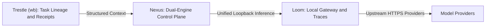

# Evan Zhang (`@xdlkc`)

English | [简体中文](./README.zh-CN.md)

**Agent Application Engineer (Full Stack)** in Beijing — previously a Java backend engineer, now building local-first developer infrastructure, agent control planes, native macOS utilities, and composable agent workflows.

- **Technical Blog & Notes**: [xdlkc.github.io](https://xdlkc.github.io) ([source](https://github.com/xdlkc/xdlkc.github.io))
- **Contact**: [wimness@163.com](mailto:wimness@163.com)

---

## Engineering Focus

My 2026 work centers on treating **isolation, observability, and explicit verification** as first-class primitives in agent systems: keeping credentials on loopback, decoupling task state from ephemeral model sessions, and building fast native tools in Rust, TypeScript, and Swift.

---

## 2026 Portfolio

### 1. Agent Control Planes & Gateways

| Repository | Description |
| --- | --- |
| [`nexus`](https://github.com/xdlkc/nexus) | Event-driven, dual-engine Super-Agent control plane (`Gate -> Jev -> Router`) in Rust + React/TypeScript, orchestrating isolated Git worktree workers (`codex`, `claude-code`, `pi-native`, `pi-rpc`, `opencode`) across IM and GitHub. |
| [`loom`](https://github.com/xdlkc/loom) | Local-only unified Rust model gateway (`127.0.0.1:4319`) for OpenAI & Anthropic APIs with loopback observability console (`127.0.0.1:4320`), client config sync, and zero Python/Node runtime dependencies. |
| [`trestle`](https://github.com/xdlkc/trestle) | **Trestle (栈架)** — Local-first Rust workbench (`wb`) separating task lineage, handoff briefs, read-only Git observations, and receipt-driven delivery verification from external codebases. |

### 2. Local-First Native Apps & Browser Extensions

| Repository | Description |
| --- | --- |
| [`verba`](https://github.com/xdlkc/verba) | **Verba (言辞)** — Native macOS bilingual live subtitles (CoreAudio Process Tap + on-device speech recognition), structured meeting notes with fishbone diagrams, pinyin search & Obsidian sync via Rust + Loom. |
| [`gloss`](https://github.com/xdlkc/gloss) | **Gloss (眉批)** — Lightweight Manifest V3 browser extension for layout-preserving bilingual webpage translation and a streaming AI reading, vision & writing sidebar. |
| [`vestige`](https://github.com/xdlkc/vestige) | **Vestige (余痕)** — Native macOS menu bar clipboard history manager (`Swift`/`AppKit`) with global hotkey recall, fuzzy search, type filters, SQLite persistence & direct paste. |
| [`scribeleaf`](https://github.com/xdlkc/scribeleaf) | Native macOS Markdown editor (`AppKit` + `WKWebView` + `CodeMirror 6`) for live preview, tables, themes, and PDF/PNG/Pandoc export. |
| [`mini-codex`](https://github.com/xdlkc/mini-codex) | Rust Codex CLI, `ratatui` TUI, and native macOS desktop workspace (`tao` + `wry`) supporting Responses API, worktrees, PTY terminal, MCP & SSH remote agents. |

### 3. Composable Agent Skills & Creative Pipelines

| Repository | Description |
| --- | --- |
| [`lstack`](https://github.com/xdlkc/lstack) | Personal Agent Skills stack (`code-review`, `tdd`, `grill-me`, `grilling`) across Antigravity, Claude Code, Codex, Gemini CLI & Cursor. |
| [`skill-dissector`](https://github.com/xdlkc/skill-dissector) | Agent Skill that dissects how other skills work across 6 layers (triggers, flow, context, tooling, steering) with observed-vs-inferred reports. |
| [`ai-video-production`](https://github.com/xdlkc/ai-video-production) | Multi-model AI short-film skill (`Claude` Director + `Codex` Illustrator + `Seedance` Animator) engineered to catch errors before paid video generation. |
| [`notebooklm-workflow`](https://github.com/xdlkc/notebooklm-workflow) | Modular Google NotebookLM automation skills for ebook/blog ingestion, Studio prompts, slide deck QA, and Drive delivery. |
| [`terminal-visual-qa`](https://github.com/xdlkc/terminal-visual-qa) | Agent Skill and macOS script for isolated `iTerm2` and `Terminal.app` UI screenshot verification without disturbing active windows. |
| [`save-and-summary-anything`](https://github.com/xdlkc/save-and-summary-anything) | Hermes Agent skill and Python Chrome-CDP CLI to detect web articles, archive Markdown + images/GIFs locally, and summarize. |
| [`maoxuan`](https://github.com/xdlkc/maoxuan) | Ten analytical and strategic thinking skills for AI agents distilled from Mao Zedong's Selected Works (Vols. 1–5), packaged with a Claude Code plugin. |

### 4. Developer Tooling, Deep-Dive Research & Arena

| Repository | Description |
| --- | --- |
| [`SkillHub`](https://github.com/xdlkc/SkillHub) | Local web registry and manager for AI agent skill repositories: catalog, tag, shallow-clone, inspect `SKILL.md`, and install/diff across 73 agents. |
| [`skills-manager`](https://github.com/xdlkc/skills-manager) | TypeScript CLI for installing, listing, and uninstalling AI CLI skills across Claude Code and OpenCode with `.source.json` Git provenance. |
| [`AgentForge`](https://github.com/xdlkc/AgentForge) | Agent Skills package implementing Spec-Driven Development (SDD): six-phase workflow, EARS templates, and spec scaffolding/validation scripts. |
| [`evan-llm-wiki`](https://github.com/xdlkc/evan-llm-wiki) | Generic queue-driven toolkit for agent-maintained Markdown LLM wikis using `codex exec` and plain-file queue state. |
| [`uncle-bob-harness`](https://github.com/xdlkc/uncle-bob-harness) | Out-of-tree DeepSeek Harness TypeScript FSM bundle (`Specifier -> Coder -> Cleaner -> Hardener -> QA`) enforced by deterministic host gates. |
| [`deepseek-harness-explained`](https://github.com/xdlkc/deepseek-harness-explained) | Evidence-backed architectural teardown of DeepSeek Harness (Cordis runtime, Session Event Log, commit evolution) with keyless session replay. |
| [`rock-marketplace`](https://github.com/xdlkc/rock-marketplace) · [`rock-agents`](https://github.com/xdlkc/rock-agents) · [`rock-cli-skills`](https://github.com/xdlkc/rock-cli-skills) | Modular Claude Code plugin marketplace, `rock.sdk.agent` debugging plugins, and standalone `rockcli` skills for ROCK sandboxes and Harbor benchmarks. |
| [`llm-texas-holdem`](https://github.com/xdlkc/llm-texas-holdem) | 1-human + multi-LLM & multi-CLI-agent No-Limit Texas Hold'em web arena with dual OpenAI/Anthropic protocols, CSPRNG dealing, and SQLite replay. |
| [`ai-trading-clone`](https://github.com/xdlkc/ai-trading-clone) | Static React replica of the AI-Trading Strategy Plaza and Research Detail dashboard with SVG financial charts and sanitized JSON mock datasets. |

---

## Writing

Long-form engineering memos, architecture teardowns, and audio-accompanied technical notes are published at **[https://xdlkc.github.io](https://xdlkc.github.io)**.
