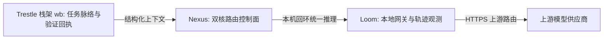

# Evan Zhang (`@xdlkc`)

[English](./README.md) | 简体中文

**Agent 应用工程师（全栈）**，工作地北京——早年从事 Java 后端开发，当前专注于本地优先开发者基础设施、Agent 控制面、原生 macOS 工具与可组合工作流工程实践。

- **技术博客与架构笔记**：[xdlkc.github.io](https://xdlkc.github.io)（[源码仓库](https://github.com/xdlkc/xdlkc.github.io)）
- **联系邮箱**：[wimness@163.com](mailto:wimness@163.com)

---

## 工程关注方向

2026 年的工程实践围绕**隔离性、可观测性与显式验证**展开：将上游凭据严格收敛在本机回环网关内，将长期任务脉络与单次易逝对话解耦，并基于 Rust、TypeScript 与 Swift 构建轻量、可控的本地原生工具链。

---

## 2026 活跃项目矩阵

### 1. Agent 控制面与模型网关

| 仓库 | 简介 |
| --- | --- |
| [`nexus`](https://github.com/xdlkc/nexus) | 事件驱动、双核路由（`Gate -> Jev -> Router`）的 Super-Agent 控制面（Rust + React/TypeScript），以独立身份沙箱与 Git Worktree 并发调度多态 Worker（`codex`、`claude-code`、`pi-native`、`pi-rpc`、`opencode`）。 |
| [`loom`](https://github.com/xdlkc/loom) | 本机专用的纯 Rust 模型统一网关（`127.0.0.1:4319`）与回环可观测管控台（`127.0.0.1:4320`），兼容 OpenAI / Anthropic 协议与多客户端配置同步，零 Python / Node.js 运行时依赖。 |
| [`trestle`](https://github.com/xdlkc/trestle) | **Trestle（栈架）** — 本地优先的 Rust 个人工作台（`wb`），将任务登记、秒级交接简报、只读 Git 观察与回执驱动交付核验与外部源码仓库彻底解耦。 |

### 2. 本地优先原生应用与浏览器扩展

| 仓库 | 简介 |
| --- | --- |
| [`verba`](https://github.com/xdlkc/verba) | **言辞（Verba）** — 基于 Rust + Loom 的原生 macOS 实时双语字幕、鱼骨图会议纪要、拼音音近检索与 Obsidian 同步工具（CoreAudio Process Tap + 设备端语音识别）。 |
| [`gloss`](https://github.com/xdlkc/gloss) | **眉批（Gloss）** — 轻量级 Manifest V3 浏览器扩展，支持不破排版的双语对照翻译与流式思考 AI 阅读、识图、写作侧边栏。 |
| [`vestige`](https://github.com/xdlkc/vestige) | **余痕（Vestige）** — 原生 macOS 菜单栏剪贴板历史工具（`Swift`/`AppKit`），支持全局热键唤出、模糊搜索、类型筛选、SQLite 持久化与回车直贴。 |
| [`scribeleaf`](https://github.com/xdlkc/scribeleaf) | 基于 `AppKit` + `WKWebView` + `CodeMirror 6` 的原生 macOS Markdown 编辑器，支持实时预览、表格、主题与 PDF/PNG/Pandoc 多格式导出。 |
| [`mini-codex`](https://github.com/xdlkc/mini-codex) | 基于 Rust 实现的 Codex CLI、`ratatui` TUI 与原生 macOS 桌面工作区（`tao` + `wry`），支持 Responses API、Worktree、PTY 终端、MCP 与 SSH 远程代理。 |

### 3. 可组合 Agent Skills 与内容流水线

| 仓库 | 简介 |
| --- | --- |
| [`lstack`](https://github.com/xdlkc/lstack) | 面向工程与效率的个人 Agent Skills 技术栈（`code-review`、`tdd`、`grill-me`、`grilling`），兼容 Antigravity、Claude Code、Codex、Gemini CLI 与 Cursor。 |
| [`skill-dissector`](https://github.com/xdlkc/skill-dissector) | 从触发设计、控制流、渐进式披露、脚本边界等 6 层剖析其他 Skill 的原理分析技能，严格区分实测事实与推理判断。 |
| [`ai-video-production`](https://github.com/xdlkc/ai-video-production) | 多模型协作 AI 短片制作流水线（`Claude` 总导演 + `Codex` 画师 + `Seedance` 动画师），在进入按秒计费的视频生成前提前拦截错误。 |
| [`notebooklm-workflow`](https://github.com/xdlkc/notebooklm-workflow) | 模块化 Google NotebookLM 自动化技能集，覆盖整书/博客导入、Studio 提示词生成、幻灯片质量验收与 Drive 交付。 |
| [`terminal-visual-qa`](https://github.com/xdlkc/terminal-visual-qa) | 面向 macOS `iTerm2` / `Terminal.app` 的隔离窗口终端 UI 截图验收技能与自动化脚本，不打断当前工作终端。 |
| [`save-and-summary-anything`](https://github.com/xdlkc/save-and-summary-anything) | Hermes Agent 技能与 Python Chrome-CDP CLI，自动识别正文文章并本地归档 Markdown、图片/GIF 与摘要。 |
| [`maoxuan`](https://github.com/xdlkc/maoxuan) | 从《毛泽东选集》第 1–5 卷提炼的 10 件 AI Agent 通用思维方法武器，配套 Claude Code 插件与评测集。 |

### 4. 开发者工具、深度研究与竞技场

| 仓库 | 简介 |
| --- | --- |
| [`SkillHub`](https://github.com/xdlkc/SkillHub) | 本地 Web 版 Agent Skill 仓库管理台：收录编目、打标、浅克隆、`SKILL.md` 预览及面向 73 款 Agent 的安装/差异对比。 |
| [`skills-manager`](https://github.com/xdlkc/skills-manager) | 基于 TypeScript 的 CLI 工具，用于跨 Claude Code 与 OpenCode 安装、列举、卸载技能并记录 `.source.json` Git 溯源。 |
| [`AgentForge`](https://github.com/xdlkc/AgentForge) | 落地规约驱动开发（SDD）的 Agent Skills 工具包，提供六阶段工作流、EARS 需求模板与规约生成/校验脚本。 |
| [`evan-llm-wiki`](https://github.com/xdlkc/evan-llm-wiki) | 基于 `codex exec` 与纯文件队列状态的通用 Agent 维护 Markdown LLM Wiki 工具集。 |
| [`uncle-bob-harness`](https://github.com/xdlkc/uncle-bob-harness) | 面向 DeepSeek Harness 的外部 TypeScript 状态机插件包，以宿主机确定性门禁驱动 `Specifier -> Coder -> Cleaner -> Hardener -> QA` 流水线。 |
| [`deepseek-harness-explained`](https://github.com/xdlkc/deepseek-harness-explained) | 基于源码提交证据的 DeepSeek Harness（Cordis 运行时、Session Event Log、架构演化）深度技术拆解与无 Key 会话回放实验。 |
| [`rock-marketplace`](https://github.com/xdlkc/rock-marketplace) · [`rock-agents`](https://github.com/xdlkc/rock-agents) · [`rock-cli-skills`](https://github.com/xdlkc/rock-cli-skills) | 面向 ROCK 沙箱与 Harbor 基准评测的统一 Claude Code 插件市场、`rock.sdk.agent` 专项调试插件及独立 `rockcli` 技能包。 |
| [`llm-texas-holdem`](https://github.com/xdlkc/llm-texas-holdem) | 支持 OpenAI 与 Anthropic 双协议的「1 人 + 多大模型 / CLI Agent」无限注德州扑克 Web 竞技场（CSPRNG 发牌 + SQLite 回放）。 |
| [`ai-trading-clone`](https://github.com/xdlkc/ai-trading-clone) | AI Trading 策略广场与研报详情页的静态 React 交互复刻，内置 SVG 金融图表与脱敏 Mock 数据集。 |

---

## 技术写作

长篇工程备忘录、系统架构拆解与配套语音精讲均持续发布于 **[https://xdlkc.github.io](https://xdlkc.github.io)**。
